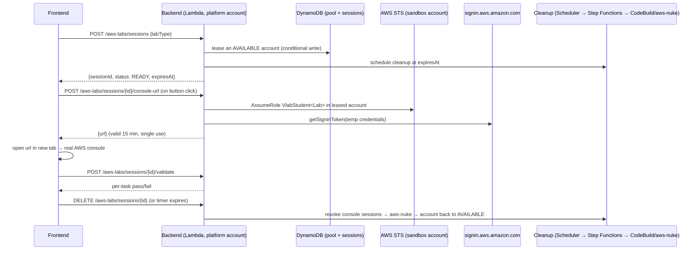

# AWS Console Labs (EC2, S3, IAM): Design & Implementation Guide

Audience: backend, frontend and platform/infra developers.

This guide describes three **real AWS Management Console** labs:

| Lab ID | What the student does | Lands on |
|---|---|---|
| `aws-ec2` | Launch/stop/terminate instances, security groups, key pairs, volumes, VPC basics | EC2 console |
| `aws-s3` | Buckets, uploads, versioning, lifecycle rules, bucket policies | S3 console |
| `aws-iam` | Users, groups, roles, policies, password policy | IAM console |

**Isolation model:** every student gets a **dedicated AWS account** for the duration of their lab, taken from a pool of
sandbox accounts in our AWS Organization. No two students ever share an account at the same time, so nobody can see
anyone else's work. When the lab ends, the account is wiped and returned to the pool.

**No Docker / ECS is involved.** These labs are not containers. The backend calls AWS STS and the AWS federation
sign-in endpoint directly and hands the browser a one-time console login link. Cleanup runs aws-nuke in AWS CodeBuild,
so there is no container image to maintain.

**Infrastructure is code:** everything in section 3 is implemented in
[`terraform-aws-sandbox/`](../terraform-aws-sandbox/README.md) in the infra repo. Backend developers only need its
`terraform output` values; they do not create any of it by hand.

---

## 1. Big picture



### Account layout

| Account | Role in this design |
|---|---|
| **Management account** (Organizations root) | Creates new sandbox accounts (account vending). Nothing else. |
| **Platform account** (where this repo's infra + the app repo's API live) | Runs the backend Lambdas, DynamoDB tables, cleanup jobs. |
| **Sandbox accounts** `vlab-sbx-001 … vlab-sbx-NNN` | In OU `Sandbox-Labs`. Each is leased to one student at a time. |

> Never use the management account or the platform account as a sandbox. Both must be on the aws-nuke blocklist.

---

## 2. Time limits

There are two different clocks:

| Clock | Value | Set by |
|---|---|---|
| **Lab lease**: how long the student owns the sandbox account | Configurable per lab. Default **60 min**, optional one-time **+30 min** extension | Backend config |
| **Console login**: how long one console sign-in lasts | **Max 1 hour** (AWS limit for credentials obtained by a Lambda assuming another role, i.e. role chaining) | AWS |
| **Sign-in link**: how long the URL is usable | **15 minutes**, use it once | AWS |

Consequences:
- The console session can end before the lab does (for example on a 90-minute lab). The student just clicks **Open AWS
  Console** again; the backend issues a new link. Their resources are untouched because the account is still theirs.
- Always generate the link **on click**, never at page load.

Suggested defaults (keep in backend config, not hard-coded in the frontend):

```json
{
  "aws-ec2": { "durationMinutes": 60, "maxExtensions": 1, "extensionMinutes": 30 },
  "aws-s3":  { "durationMinutes": 45, "maxExtensions": 1, "extensionMinutes": 30 },
  "aws-iam": { "durationMinutes": 45, "maxExtensions": 1, "extensionMinutes": 30 }
}
```

---

## 3. Platform setup (infra team, Terraform)

Implemented in [`terraform-aws-sandbox/`](../terraform-aws-sandbox/README.md), a separate Terraform root applied
manually by an admin because it needs management-account credentials. Its README has the prerequisites, apply steps,
how to add the first accounts and how to switch cleanup from dry run to real.

| Piece | Where | Summary |
|---|---|---|
| OU `Sandbox-Labs` | `organization.tf` | All sandbox accounts live here |
| SCP region lock | `organization.tf` | Only `ap-south-1` (global services such as IAM/STS excepted) |
| SCP cost guardrails | `organization.tf` | `t2.micro`/`t3.micro` only, volumes ≤ 30 GiB, no NAT/VPN/TGW/reserved/marketplace |
| SCP protect platform | `organization.tf` | Students cannot touch `Vlab*` roles/policies, account alias, budgets, S3 account public-access block, CloudTrail; **no CloudShell**; every user/role created must carry permissions boundary `VlabStudentBoundary` |
| Baseline StackSet | `stackset.tf`, `templates/sandbox-baseline.yaml` | Auto-deployed into every account in the OU: `VlabStudentEC2` / `VlabStudentS3` / `VlabStudentIAM`, `VlabStudentBoundary`, `VlabValidatorRole`, `VlabCleanupRole`, monthly budget alert |
| Account vending role | `stackset.tf` | `VlabAccountVendingRole` in the management account, for the pool manager |
| Pool table | `platform.tf` | `vlab-dev-aws-sandbox-accounts` + GSI `status-index` |
| Lambda IAM roles | `platform.tf` | `vlab-dev-aws-lab-broker`, `vlab-dev-aws-lab-validator`, `vlab-dev-aws-pool-manager` (attach to the app-repo Lambdas) |
| End-of-lab schedules | `platform.tf` | Scheduler group `vlab-dev-aws-labs` + role that may start the cleanup workflow |
| Cleanup | `cleanup.tf`, `cleanup/buildspec.yml` | Step Functions `vlab-dev-aws-lab-cleanup` → CodeBuild running aws-nuke (see 5.3) |
| Alerts | `platform.tf` | SNS `vlab-dev-aws-lab-alerts`: cleanup failures/quarantines |
| Sessions index | main `terraform/dynamodb.tf` | GSI `byStudent` on `vlab-sessions` |

Why CloudShell is blocked: its home directory persists per IAM role, so the next student leasing the same account would
see the previous student's files.

Why S3 public access stays blocked: the account-level Block Public Access is on (set when the account joins the pool and
re-applied by every cleanup), and students cannot turn it off. This stops our accounts from hosting public content
(phishing, malware). Static website hosting can be configured and explained, but not made public.

Required one-time admin steps (also in the Terraform README):
1. Organizations: all features + SCPs enabled; StackSets trusted access activated.
2. Request a higher Organizations account quota (new orgs often start around 10). Ask early, it can take days.
3. Pick an email scheme for sandbox root emails, e.g. `aws-sandbox+001@<your-domain>`.

---

## 4. Data model

### 4.1 Pool table: `vlab-dev-aws-sandbox-accounts`

| Attribute | Type | Notes |
|---|---|---|
| `accountId` (PK) | S | 12-digit ID |
| `accountAlias` | S | `vlab-sbx-001` |
| `status` | S | `PROVISIONING` \| `AVAILABLE` \| `LEASED` \| `CLEANING` \| `QUARANTINED` |
| `leaseSessionId` | S | Set while `LEASED` / `CLEANING` |
| `leaseExpiresAt` | N | Epoch seconds |
| `lastCleanedAt`, `cleanupStartedAt`, `quarantinedAt` | S | ISO-8601, written by the cleanup workflow |
| `cleanupAttempts` | N | Reset to 0 on success |
| `createdAt` | N | |

GSI `status-index` (PK `status`) to find free accounts.

### 4.2 Session item (in `vlab-sessions`)

| Attribute | Notes |
|---|---|
| `sessionId` (PK) | UUID |
| `kind` | `"aws-console"` (distinguishes from container labs) |
| `labType` | `aws-ec2` \| `aws-s3` \| `aws-iam` |
| `studentId` | From auth token, never from request body |
| `accountId` | Leased sandbox account |
| `status` | `READY` \| `ENDING` (cleanup running) \| `ENDED` \| `ERROR` |
| `endReason` | `USER` (End-lab button) \| `EXPIRED` (timer); set by the cleanup workflow |
| `createdAt`, `expiresAt` | Epoch seconds |
| `extensionsUsed` | N |
| `bucketPrefix` | e.g. `vlab-7f3a9c` (S3 bucket names are globally unique across all of AWS; the S3 lab asks students to use this prefix) |
| `lastValidation` | Last validate result (JSON) |

---

## 5. Backend logic (app repo)

### 5.1 Pool manager (scheduled Lambda, every 5 min)

Keeps a buffer of ready accounts so students do not wait, and grows the pool when demand grows (1 today, 200+ later).

```
MIN_FREE_ACCOUNTS = 3          # tune with demand
MAX_POOL_ACCOUNTS = 20         # raise with the Organizations quota

free  = count(status = AVAILABLE)
total = count(all, excluding QUARANTINED)
if free < MIN_FREE_ACCOUNTS and total < MAX_POOL_ACCOUNTS:
    create (MIN_FREE_ACCOUNTS - free) accounts:
      1. assume VlabAccountVendingRole (management account)
      2. organizations.create_account(Email=aws-sandbox+NNN@..., AccountName=vlab-sbx-NNN)
      3. poll describe_create_account_status until SUCCEEDED (can take several minutes)
      4. organizations.move_account(→ Sandbox-Labs OU)  → StackSet auto-deploys baseline
      5. via OrganizationAccountAccessRole: iam.create_account_alias(vlab-sbx-NNN)  (aws-nuke requires an alias)
         and s3control.put_public_access_block(all four settings = true)
      6. put pool item status=PROVISIONING
next run: for PROVISIONING accounts, check StackSet instance status == CURRENT → set AVAILABLE
also:     alert if any account is QUARANTINED or CLEANING for > 30 min
```

Notes:
- **Reuse accounts; don't close them.** AWS limits how many accounts can be closed in a period, and closing/creating is slow.
- A brand-new account can briefly fail EC2 launches while AWS verifies it. Optionally launch-and-terminate a `t3.micro`
  from `VlabCleanupRole` before marking it `AVAILABLE`.

### 5.2 API endpoints

All endpoints require the student's auth token. `studentId` comes from the token.

| Method & path | Purpose |
|---|---|
| `GET  /aws-labs` | Lab catalog + per-lab task list (static config) |
| `POST /aws-labs/sessions` | Start a lab. Body `{ "labType": "aws-ec2" }` |
| `GET  /aws-labs/sessions/{id}` | Status, `expiresAt`, last validation |
| `POST /aws-labs/sessions/{id}/console-url` | Fresh one-time console login link |
| `POST /aws-labs/sessions/{id}/validate` | Check the student's work |
| `POST /aws-labs/sessions/{id}/extend` | +N minutes (if allowed) |
| `DELETE /aws-labs/sessions/{id}` | End lab now |

**Never return AWS credentials to the browser**, only the sign-in URL.

#### `POST /aws-labs/sessions`: start

```
1. Validate labType ∈ {aws-ec2, aws-s3, aws-iam}.
2. If the student already has a session with kind=aws-console and status=READY → 409 ALREADY_ACTIVE (return that sessionId).
3. Lease an account:
     candidates = query status-index where status = AVAILABLE (limit 5)
     for acct in candidates:
        try UpdateItem(acct)
              SET status=LEASED, leaseSessionId=:sid, leaseExpiresAt=:exp
              ConditionExpression: status = :AVAILABLE        ← atomic, two students can never get the same account
           break
        except ConditionalCheckFailed: continue
     none leased → 503 NO_CAPACITY { retryAfterSeconds: 60 } and invoke pool manager async
4. Put session item (status=READY, expiresAt=now+duration, bucketPrefix="vlab-"+sessionId[:6]).
5. EventBridge Scheduler (group from `terraform output scheduler`): one-time schedule "end-<sessionId>",
   ScheduleExpression "at(<expiresAt as yyyy-mm-ddThh:mm:ss>)", ScheduleExpressionTimezone "UTC",
   ActionAfterCompletion=DELETE, target = cleanup state machine ARN, RoleArn = scheduler role,
   input {"sessionId": ..., "accountId": ..., "reason": "EXPIRED"}.
6. 201 { sessionId, labType, status, region:"ap-south-1", expiresAt, bucketPrefix, tasks }
```

#### `POST /aws-labs/sessions/{id}/console-url`: login link

```python
import json, time, urllib.parse, urllib.request
import boto3

sts = boto3.client("sts")

LAB_ROLE = {"aws-ec2": "VlabStudentEC2", "aws-s3": "VlabStudentS3", "aws-iam": "VlabStudentIAM"}
CONSOLE_DESTINATION = {
    "aws-ec2": "https://ap-south-1.console.aws.amazon.com/ec2/home?region=ap-south-1#Home:",
    "aws-s3":  "https://s3.console.aws.amazon.com/s3/home?region=ap-south-1",
    "aws-iam": "https://console.aws.amazon.com/iam/home#/home",
}
ISSUER = "https://<your-lab-portal-domain>"   # shown on the AWS "session expired" page
FEDERATION = "https://signin.aws.amazon.com/federation"


def create_console_url(session: dict) -> str:
    # Caller must already have checked: session belongs to student, status == READY, not expired.
    remaining = int(session["expiresAt"] - time.time())
    duration = max(900, min(3600, remaining))   # STS min 15 min; role chaining max 1 h

    creds = sts.assume_role(
        RoleArn=f"arn:aws:iam::{session['accountId']}:role/{LAB_ROLE[session['labType']]}",
        RoleSessionName=f"vlab-{session['sessionId']}"[:64],
        SourceIdentity=f"student-{session['studentId']}"[:64],   # appears in CloudTrail for every action
        DurationSeconds=duration,
        Tags=[{"Key": "VlabSessionId", "Value": session["sessionId"]}],
    )["Credentials"]

    session_json = json.dumps({
        "sessionId": creds["AccessKeyId"],
        "sessionKey": creds["SecretAccessKey"],
        "sessionToken": creds["SessionToken"],
    })
    token_url = FEDERATION + "?" + urllib.parse.urlencode({"Action": "getSigninToken", "Session": session_json})
    with urllib.request.urlopen(token_url, timeout=10) as resp:
        signin_token = json.load(resp)["SigninToken"]

    return FEDERATION + "?" + urllib.parse.urlencode({
        "Action": "login",
        "Issuer": ISSUER,
        "Destination": CONSOLE_DESTINATION[session["labType"]],
        "SigninToken": signin_token,
    })
```

Response: `{ "url": "...", "linkExpiresAt": now+900, "consoleSessionExpiresAt": now+duration }`.
Do not log the URL; it is a bearer credential for 15 minutes.

Note: if the remaining lab time is < 15 min, the console session (min 15 min) can outlive the lab. That's fine:
cleanup revokes it (step 1 below).

#### `POST /aws-labs/sessions/{id}/validate`: check work

Assume `VlabValidatorRole` (read-only) in the session's account and evaluate the lab's task list. Because each student
has their own account, checks can look at the *whole* account. Return:

```json
{
  "score": 3, "total": 5,
  "tasks": [
    { "id": "ec2-launch", "title": "Launch a t2.micro instance named web-server", "passed": true,  "message": "Found i-0abc… (running)" },
    { "id": "ec2-sg-http", "title": "Allow HTTP (80) in security group web-sg",   "passed": false, "message": "web-sg has no inbound rule for port 80" }
  ]
}
```

Rate-limit to e.g. 1 call / 10 s per session. Store the result on the session for grading.

Starter task sets (put in backend config so content can change without code changes):

**aws-ec2**
| id | Task | Check |
|---|---|---|
| `ec2-keypair` | Create key pair `lab-key` | `ec2.describe_key_pairs(KeyNames=["lab-key"])` |
| `ec2-sg` | Security group `web-sg` allowing 22 and 80 | `describe_security_groups` → ingress ports include 22, 80 |
| `ec2-launch` | Launch t2.micro/t3.micro tagged `Name=web-server` using `lab-key` + `web-sg` | `describe_instances` filter tag + state `running` |
| `ec2-volume` | Create & attach an 8 GiB gp3 volume to `web-server` | `describe_volumes` attached to that instance |
| `ec2-stop` | Stop the instance | state `stopped` |

**aws-s3**
| id | Task | Check |
|---|---|---|
| `s3-bucket` | Create bucket `<bucketPrefix>-data` in ap-south-1 | `head_bucket` + `get_bucket_location` |
| `s3-upload` | Upload `hello.txt` | `head_object` |
| `s3-versioning` | Enable versioning, upload `hello.txt` again | `get_bucket_versioning == Enabled` and ≥ 2 versions |
| `s3-lifecycle` | Lifecycle rule: move to Glacier after 30 days | `get_bucket_lifecycle_configuration` |
| `s3-policy` | Bucket policy denying non-HTTPS (`aws:SecureTransport=false`) | `get_bucket_policy` contains that condition |

**aws-iam**
| id | Task | Check |
|---|---|---|
| `iam-group` | Group `developers` with `AmazonS3ReadOnlyAccess` | `list_attached_group_policies` |
| `iam-user` | User `dev1` in `developers` with console password | `get_login_profile`, `get_groups_for_user` |
| `iam-password-policy` | Min length 12, require symbols | `get_account_password_policy` |
| `iam-role` | Role `ec2-s3-reader` trusted by `ec2.amazonaws.com` | `get_role` trust policy |
| `iam-custom-policy` | Customer policy allowing `s3:ListBucket` on one bucket, attached to `dev1` | `list_attached_user_policies` + policy document |

> IAM lab: every user/role must be created with permissions boundary **`VlabStudentBoundary`**, or AWS will deny the
> create. Put this in the lab instructions ("Set permissions boundary → VlabStudentBoundary"). Students can test their new
> user by signing in at `https://<accountId>.signin.aws.amazon.com/console` in a private window.

#### `POST /aws-labs/sessions/{id}/extend`

If `extensionsUsed < maxExtensions` and status is READY: bump `expiresAt` and `leaseExpiresAt`, update the Scheduler
schedule, increment `extensionsUsed`.

#### `DELETE /aws-labs/sessions/{id}`: end now

```
1. Check ownership and status == READY (otherwise 409).
2. Delete the schedule "end-<sessionId>" (ignore ResourceNotFound).
3. states.start_execution(
       stateMachineArn = <cleanup_state_machine_arn>,
       name  = "end-<sessionId>-user",
       input = {"sessionId": ..., "accountId": ..., "reason": "USER"})
4. 202 { status: "ENDING" }
```

A session can't be cleaned twice. The schedule is deleted before the manual end starts, and the workflow's
`MarkAccountAvailable` step only succeeds while the account is still `CLEANING`.

### 5.3 Cleanup workflow (implemented in Terraform; no backend code)

Step Functions `vlab-dev-aws-lab-cleanup`, input `{sessionId, accountId, reason}`:

```
MarkSessionEnding     session.status = ENDING, endReason, endedAt
MarkAccountCleaning   pool.status = CLEANING
WipeAccount           CodeBuild vlab-dev-aws-lab-cleanup (TARGET_ACCOUNT_ID = accountId), 2 retries:
                        0. refuse blocklisted accounts (management + platform), assume VlabCleanupRole, verify account id
                        1. revoke console sessions NOW: AWSRevokeOlderSessions inline deny (aws:TokenIssueTime < now)
                           on VlabStudentEC2/S3/IAM → the student's open console tab stops working within seconds
                        2. aws-nuke (only EC2/VPC/ELB/ASG/S3/IAM resource types; Vlab*/StackSet/OrgAccess roles kept)
                        3. re-apply revoke policy, recreate default VPC, re-apply S3 Block Public Access
                        4. verify: no instances, buckets, IAM users, unexpected roles; baseline roles intact
MarkAccountAvailable  pool.status = AVAILABLE (only if still CLEANING)
MarkSessionEnded      session.status = ENDED
on failure            pool.status = QUARANTINED, session ENDED, SNS alert → a human investigates.
                      A QUARANTINED account is never handed out.
```

Typical duration 5–15 minutes. The student's lab is over immediately (step 1); only the account's return to the pool
waits for the wipe. Plan the pool buffer (`MIN_FREE_ACCOUNTS`) for that.

`cleanup_dry_run = true` (the Terraform default) makes aws-nuke only list resources and then **quarantines** the
account. Switch it off only after reviewing a dry run (Terraform README).

---

## 6. Frontend logic

### 6.1 Catalog

Add three entries with a new kind so the UI does not try to open the usual container iframe:

```ts
type LabKind = "container" | "aws-console";

const awsLabs = [
  { id: "aws-ec2", kind: "aws-console", title: "Amazon EC2", durationMinutes: 60 },
  { id: "aws-s3",  kind: "aws-console", title: "Amazon S3",  durationMinutes: 45 },
  { id: "aws-iam", kind: "aws-console", title: "AWS IAM",    durationMinutes: 45 },
];
```

Fetch the real list and durations from `GET /aws-labs`; do not hard-code durations.

### 6.2 Lab page layout

```
┌──────────────────────────────────────────────────────────────────────┐
│ Amazon EC2 Lab        Region: Asia Pacific (Mumbai)   ⏱ 52:13 left   │
├───────────────────────────────┬──────────────────────────────────────┤
│ Tasks                         │  [ Open AWS Console ↗ ]              │
│ ☐ 1. Create key pair lab-key  │  Opens the real AWS console in a     │
│ ✅ 2. Security group web-sg   │  new tab. Tip: use a private window  │
│ ☐ 3. Launch web-server        │  if you are signed in to another     │
│ ...                           │  AWS account.                        │
│ [ Check my work ]             │  [ +30 min ]      [ End lab ]        │
└───────────────────────────────┴──────────────────────────────────────┘
```

### 6.3 States

| Session `status` / situation | UI |
|---|---|
| (starting request in flight) | Spinner "Preparing your AWS account…" |
| `503 NO_CAPACITY` | "All AWS lab slots are busy. Retrying in 60 s…" (auto-retry with `retryAfterSeconds`) |
| `409 ALREADY_ACTIVE` | Redirect to the existing session |
| `READY` | Normal lab page |
| `ENDING` | "Lab ended." Disable all buttons. The console is already locked; cleanup continues in the background and the student does not wait for it |
| `ENDED` | Summary: final validation score, `endReason` (`EXPIRED` → "Time is up"), "Start again" button |
| `ERROR` | Error message + contact support |

Poll `GET /aws-labs/sessions/{id}` every 30 s while on the page (and on window focus) to stay in sync with server-side
expiry.

### 6.4 Opening the console (important)

- The AWS console **cannot be shown in an iframe** (AWS blocks framing). Always open a **new tab**.
- Browsers block pop-ups opened after an `await`. Open a blank tab **synchronously in the click handler**, then
  navigate it once the URL arrives.
- Fetch a fresh URL **on every click**. Links expire after 15 minutes and are single-use.

```ts
async function openAwsConsole(sessionId: string) {
  const win = window.open("about:blank", "_blank");
  if (!win) {
    toast("Please allow pop-ups for this site to open the AWS console.");
    return;
  }
  win.document.title = "Opening AWS Console…";
  win.document.body.innerText = "Opening AWS Console…";
  try {
    const { url } = await api.post(`/aws-labs/sessions/${sessionId}/console-url`);
    win.opener = null;          // cut the link back to our page
    win.location.href = url;
  } catch (err) {
    win.close();
    showError(err);
  }
}
```

If the AWS console later says the session expired (after ≤ 1 h), the student comes back and clicks **Open AWS Console**
again. Show a hint near the button: *"Console signed out? Click again to get a new sign-in."*

### 6.5 Timer & ending

- Countdown from server `expiresAt` (correct for clock skew using the server `Date` header or a `serverTime` field).
- Warning toasts at **10 min** and **2 min**: "Your lab ends soon. Click *Check my work* now."
- Show **+30 min** only if the backend says an extension is available.
- **End lab**: confirm dialog ("All resources in your AWS account will be deleted"), then `DELETE`, then tell the
  student to close the AWS console tab.
- At expiry the backend ends the lab regardless of the frontend; the frontend just reflects the status.

### 6.6 Do not

- Do not store or display AWS credentials, account root info, or the sign-in URL anywhere persistent (no localStorage, no logs, no analytics).
- Do not let the student pick the account or region; both come from the backend.

---

## 7. Security checklist

- [ ] Sandbox accounts only in OU `Sandbox-Labs`; SCPs 1–3 attached and tested.
- [ ] Management + platform account IDs on the aws-nuke blocklist.
- [ ] Student roles trust **only** the broker Lambda role; validator/cleanup roles trust only their Lambdas/tasks.
- [ ] `SourceIdentity = student-<id>` set on every AssumeRole (CloudTrail answers "who did this").
- [ ] Account leasing uses a DynamoDB conditional write.
- [ ] Revocation runs **before** nuke; revoke policy survives nuke (tested).
- [ ] CloudShell denied (SCP).
- [ ] S3 Block Public Access on at account level, cannot be changed by students.
- [ ] Budgets + SNS alerts on every sandbox account; Cost Anomaly Detection at the org level.
- [ ] Alert on any account in `QUARANTINED`, or in `CLEANING` > 30 min.
- [ ] Student-created IAM users/roles/access keys are deleted by nuke at lab end (and are boundary-limited meanwhile).

## 8. Cost notes

- Sandbox accounts themselves cost nothing; idle pool accounts cost ~0.
- Student usage is bounded by SCPs: micro instances only, ≤ 30 GiB volumes, no NAT gateways/VPN/reserved capacity,
  ap-south-1 only. A 60-minute EC2 lab with one micro instance costs on the order of one US cent (check current
  ap-south-1 pricing).
- Cleanup: a few minutes of a small CodeBuild instance per lab session.
- Biggest risk is a cleanup failure leaving instances running → the QUARANTINED alert + budget alerts cover this.

## 9. Rollout plan

1. **Infra:** apply `terraform-aws-sandbox/` (section 3).
   Create **2 accounts manually** to start.
2. **Infra:** dry-run aws-nuke on one account; then a real run; verify revoke-policy survival.
3. **Backend:** start / console-url / end + cleanup workflow. Test end-to-end with one account.
4. **Frontend:** catalog, lab page, open-console flow, timer, states.
5. **Backend:** validate endpoint + task configs for EC2, S3, IAM.
6. **Backend:** pool manager (auto-create accounts), alerts. Raise `MAX_POOL_ACCOUNTS` as the Organizations quota allows.
7. Pilot with a small class; watch budgets, cleanup times and quarantines before scaling up.
